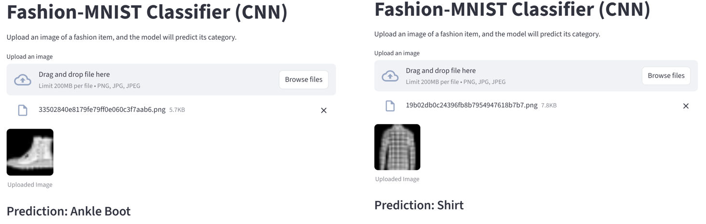
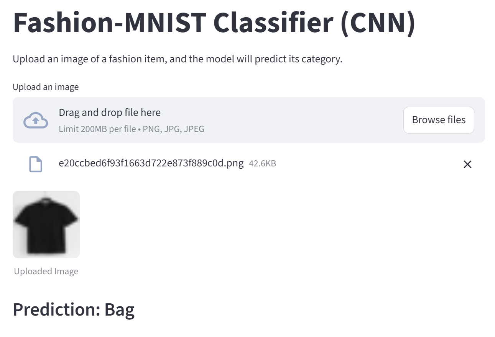
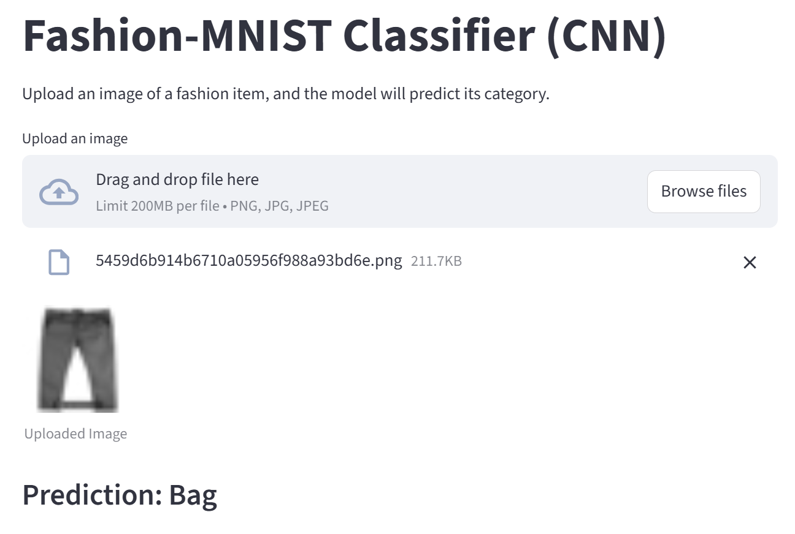

# Fashion-MNIST Classification: Classical ML Comparison and CNN Demo

A concise portfolio version of an NUS CS3244 Machine Learning group project. The repository compares three classical classifiers—with and without PCA—and includes a Streamlit inference application built around the team's baseline CNN checkpoint.

**Live demo:** [fashion-mnist-app-geqchmqqdsecn2lfivdnkg.streamlit.app](https://fashion-mnist-app-geqchmqqdsecn2lfivdnkg.streamlit.app/)

## Dataset

[Fashion-MNIST](https://github.com/zalandoresearch/fashion-mnist) contains 70,000 grayscale images across 10 clothing categories. Each image is 28×28 pixels. The standard split provides 60,000 training images and 10,000 test images.

## Problem formulation

The task is supervised multiclass image classification: predict one of 10 Fashion-MNIST labels from a grayscale clothing image.

For the classical experiments, each 28×28 image is flattened to 784 features and scaled to `[0, 1]`. The notebook evaluates:

- Logistic Regression (`max_iter=1000`)
- RBF-kernel Support Vector Machine, trained on a 10,000-image subset
- Random Forest with 100 trees
- Each classifier again after reducing the inputs to 100 principal components with PCA

## Classical ML and PCA results

These are the saved test-set results from the project notebook. The values are preserved as recorded; no metrics were regenerated or estimated during the portfolio cleanup.

| Model | Accuracy | Macro F1 |
|---|---:|---:|
| Random Forest | **0.8765** | **0.875199022** |
| Random Forest + PCA | 0.8646 | 0.86306393 |
| SVM + PCA | 0.8545 | 0.854267944 |
| SVM | 0.8531 | 0.852534942 |
| Logistic Regression | 0.8437 | 0.842868218 |
| Logistic Regression + PCA | 0.8410 | 0.839909238 |

Random Forest produced the strongest saved result. In this experiment, PCA slightly improved SVM accuracy but reduced accuracy for Random Forest and Logistic Regression. The full evaluation output and plots remain in [`notebooks/classical_ml_comparison.ipynb`](notebooks/classical_ml_comparison.ipynb), and the summary values are stored in [`results/classical_model_comparison.csv`](results/classical_model_comparison.csv).

## CNN inference

The application uses the team's baseline CNN checkpoint at `models/best_fashion_cnn.pth` (the filename is historical; it is not the team's best-performing variant). The committed architecture has two convolution/max-pooling blocks followed by a 128-unit fully connected layer and a 10-class output layer.

The team's final report found that an average-pooling variant ("V4_AvgPool", reported at 92.81% test accuracy) performed best among the CNN variants it compared. That variant's checkpoint is not included or deployed here. The report's figure and the measurement below come from separate runs and evaluation setups, so they should not be compared directly.

Inference runs on CPU. An uploaded image is converted to grayscale, resized to 28×28, scaled from `[0, 255]` to `[0, 1]`, and passed to the model. The repository does not contain the CNN training pipeline, so training is not reproduced here.

### CNN test-set evaluation

`scripts/evaluate_cnn.py` evaluates the deployed checkpoint on the official 10,000-image Fashion-MNIST test set, using the same transform as the app (`pixel / 255`, no other normalization). Result from running the script:

| Metric | Value |
|---|---:|
| Accuracy | **0.9342** |
| Macro F1 | 0.9340 |

| Class | Precision | Recall | F1 |
|---|---:|---:|---:|
| T-shirt/top | 0.8821 | 0.8980 | 0.8900 |
| Trouser | 0.9950 | 0.9920 | 0.9935 |
| Pullover | 0.8372 | 0.9310 | 0.8816 |
| Dress | 0.9497 | 0.9440 | 0.9468 |
| Coat | 0.9161 | 0.8520 | 0.8829 |
| Sandal | 0.9842 | 0.9960 | 0.9901 |
| Shirt | 0.8254 | 0.7800 | 0.8021 |
| Sneaker | 0.9742 | 0.9810 | 0.9776 |
| Bag | 0.9920 | 0.9940 | 0.9930 |
| Ankle boot | 0.9908 | 0.9740 | 0.9823 |

Shirt is the weakest class, followed by T-shirt/top, Pullover, and Coat, which are visually similar upper-body garments.

To reproduce, install the app dependencies and run the script from the repository root. It downloads the official test-set idx files from [zalandoresearch/fashion-mnist](https://github.com/zalandoresearch/fashion-mnist) into `data/fashion/` (ignored by git) on first run:

```bash
python -m pip install -r requirements.txt
python scripts/evaluate_cnn.py
```

Inference is deterministic on CPU, so a rerun should print the same values.

## Streamlit application

The app accepts PNG or JPEG uploads and displays the predicted Fashion-MNIST category. Images closest to the dataset format—a centered light item on a dark background—are the most appropriate inputs.

### Run locally

Python 3.11 or 3.12 is recommended.

```bash
python -m venv .venv
```

Activate the environment on Windows:

```powershell
.venv\Scripts\Activate.ps1
```

Or on macOS/Linux:

```bash
source .venv/bin/activate
```

Install the app dependencies and start Streamlit:

```bash
python -m pip install -r requirements.txt
streamlit run app.py
```

To inspect or rerun the classical experiments, install the notebook dependencies separately:

```bash
python -m pip install -r requirements-notebook.txt
jupyter lab notebooks/classical_ml_comparison.ipynb
```

## Failure analysis

The screenshots below were taken from an earlier version of the app interface, so their wording differs from the current app.

Dataset-style images—a light item centered on a black background—are classified correctly:



Real product photos, by contrast, were both predicted as "Bag":





Fashion-MNIST items are light on a black background, centered, and resized with their aspect ratio preserved. The app only converts an upload to grayscale and stretches it to 28×28. Real photos usually show a dark item on a light background, so they reach the model with inverted contrast and distorted proportions. These failures are therefore a preprocessing mismatch on top of genuine domain shift between studio-normalized dataset images and real photographs. The test-set accuracy above does not measure performance on such photos.

## Repository structure

```text
fashion-mnist-app/
├── app.py                              # Streamlit entry point
├── docs/
│   └── images/                         # Failure-analysis screenshots
├── models/
│   └── best_fashion_cnn.pth            # Team baseline CNN checkpoint used for inference
├── notebooks/
│   └── classical_ml_comparison.ipynb   # Classical ML and PCA experiments
├── results/
│   └── classical_model_comparison.csv  # Saved test-set metrics
├── scripts/
│   └── evaluate_cnn.py                 # CNN test-set evaluation
├── src/
│   ├── __init__.py
│   ├── model_cnn.py                    # CNN architecture definition
│   └── predict_cnn.py                  # Preprocessing and CPU inference
├── requirements.txt                    # Streamlit app dependencies
└── requirements-notebook.txt           # Classical experiment dependencies
```

## Limitations

- The CNN training code and training-time preprocessing configuration are not present, so the repository can verify checkpoint compatibility and the current inference transform, but not the full CNN training workflow.
- The deployed checkpoint is the team's baseline CNN, not the best-performing variant from the final report.
- The CNN metric above covers the Fashion-MNIST test set only; there is no labeled evaluation on real photos.
- The classical notebook does not set random seeds for PCA or Random Forest. A fresh run may therefore differ slightly from the preserved results.
- The SVM experiments use only the first 10,000 training examples to reduce runtime.
- The Streamlit demo resizes arbitrary uploads directly; it does not perform background removal, centering, or automatic color inversion.

## Next steps

Possible future work to make the demo more robust on real photos:

- Detect light backgrounds and invert the image so the item is light on dark, as in the dataset.
- Crop to the item and pad to a square before resizing, preserving the aspect ratio.
- Show the softmax confidence and abstain from predicting below a threshold.
- Evaluate on a small labeled set of real photos to measure the effect of these changes.

## Personal contribution and attribution

My individual contribution covered the Logistic Regression, SVM, Random Forest, and PCA comparison experiments. I also built the CNN inference pipeline and Streamlit application using the team's baseline CNN checkpoint.

This work originated as an NUS CS3244 group project by Chung Jia Cheng (team leader; CNN and ViT), Samantha Lee, Wu Ting, Feliana Hazlan, GU Mingrui, and Manya Wang. The CNN checkpoint is attributed to the team; this portfolio repository does not claim that I personally trained it.
